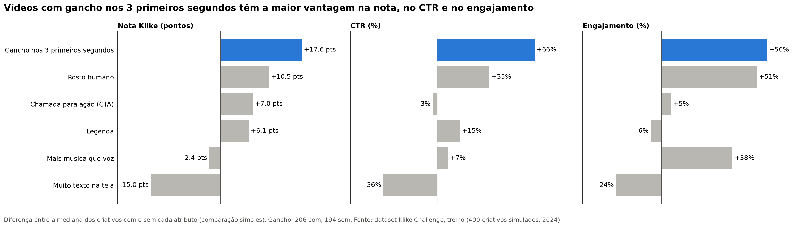
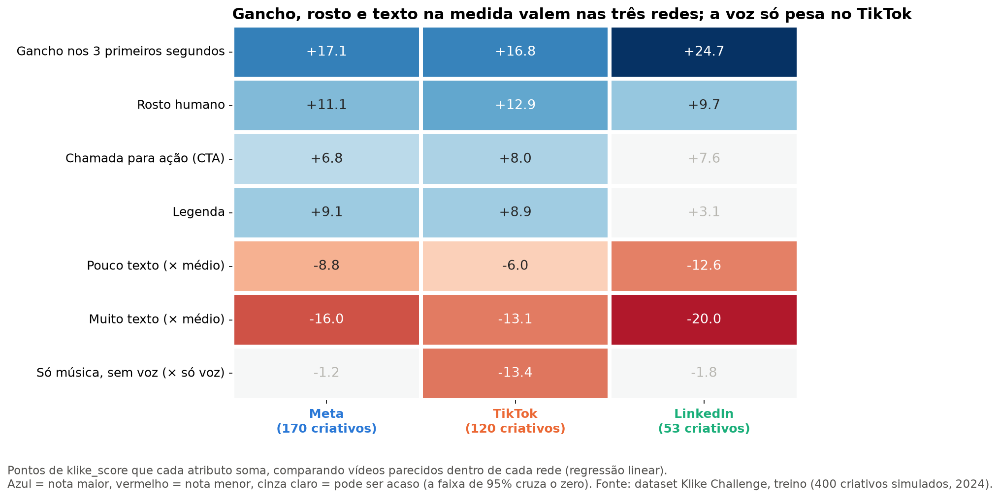
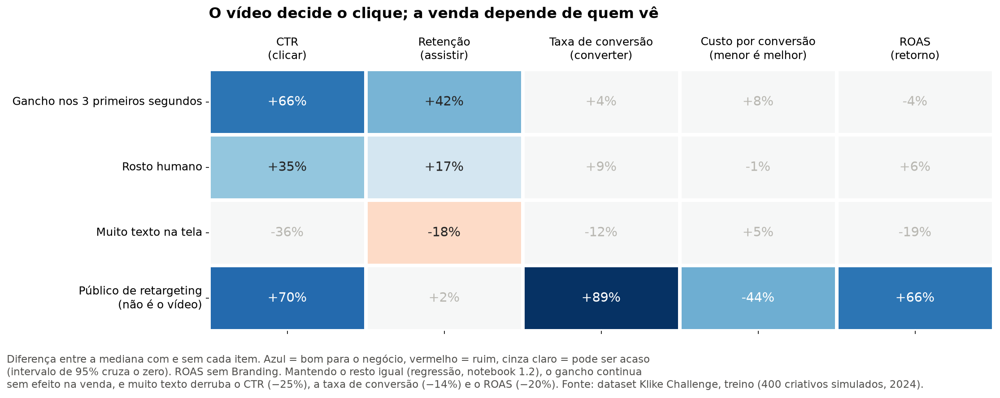
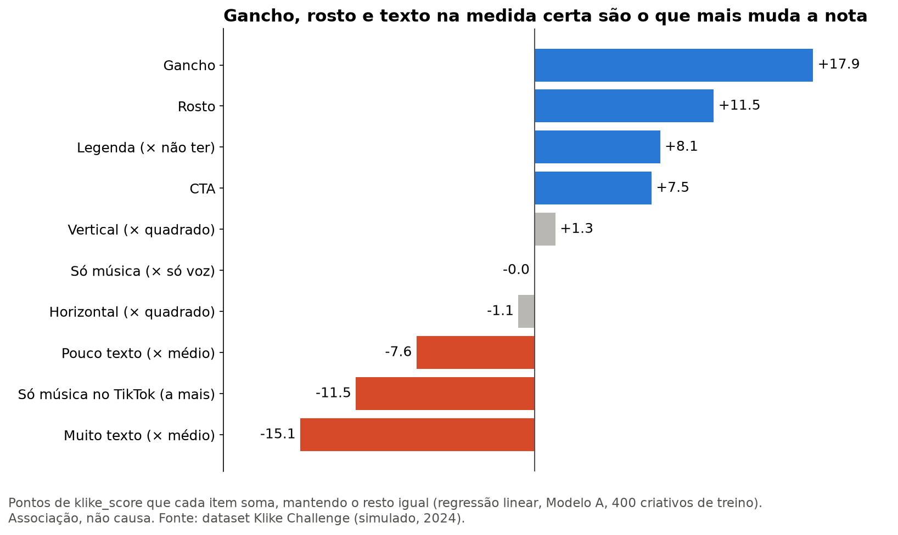
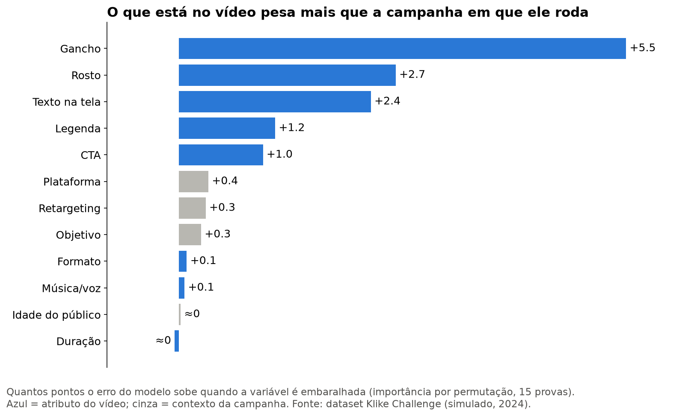

# Klike.ai — Data Science Challenge

O Klike dá uma nota de 0 a 100 a vídeos de anúncio ("criativos") e promete dizer, **antes de o vídeo ir ao ar**, se ele vai funcionar. Este trabalho responde às quatro partes do case com uma base de 500 criativos de 2024, veiculados no Meta, no TikTok e no LinkedIn:

- o que os dados mostram (Parte 1);
- um modelo que prevê a nota (Parte 2);
- um motor que sugere melhorias para cada campanha (Parte 3);
- como isso viraria um produto (Parte 4).

**Por onde ler.** Cada pergunta tem um texto explicativo em `docs/`, escrito para quem não é da área, e um notebook em `notebooks/`, com o código e o raciocínio passo a passo. Os textos seguem sempre a mesma ordem: a pergunta, a resposta curta, o que eu fiz, por que fiz assim, o que descobri e os limites.

## A história em resumo

**Parte 1: o que os dados mostram.** Antes de tudo, separei 100 vídeos como uma "prova guardada na gaveta", para testar o modelo no fim sem ter olhado para eles. Depois conferi as contas da base (o CTR, por exemplo, é cliques ÷ impressões) e encontrei 10 linhas com números digitados errado, que corrigi.

O atributo que mais pesa é o **gancho nos 3 primeiros segundos**: vídeos com gancho têm nota cerca de 17 pontos maior, mesmo comparando com vídeos parecidos em todo o resto. Depois vêm o **rosto humano** e a **quantidade certa de texto na tela**: muito texto atrapalha, e pouco também.

As três redes são muito diferentes em custo: um clique no LinkedIn custa cerca de cinco vezes o do TikTok. Mas o que funciona é quase igual nas três. A exceção é a voz, que importa no TikTok.

O achado mais útil para o marketing é que **o vídeo decide se a pessoa para e clica, mas quase não decide se ela compra**. A venda depende mais de quem vê o anúncio.

**Parte 2: um modelo que prevê a nota antes de postar.** O modelo só usa o que existe antes de publicar: as características do vídeo e da campanha. Ele nunca vê os cliques ou as vendas, que seriam o "gabarito".

Testei três modelos, e o mais simples, a **regressão linear**, foi o que menos errou. Nos 100 vídeos guardados, ele erra em média **6,7 pontos**, contra 11,7 de quem chutasse a nota média. Em 3 de cada 4 vídeos, a previsão fica a até 10 pontos da nota real, e ele encontra 3 de cada 4 dos melhores vídeos.

Um modelo que também usa os resultados da campanha erra só 1 ponto a menos. Ou seja, o vídeo sozinho já explica quase toda a nota.

**Parte 3: um motor de recomendações.** O motor funciona como um simulador de "e se": muda uma coisa no vídeo e pergunta ao modelo qual seria a nova nota. A diferença é o ganho. Ele entrega as três mudanças de maior ganho, em ordem, e leva em conta a rede e o objetivo de cada campanha. Por exemplo: "Adicionar um gancho nos 3 primeiros segundos pode aumentar a nota em ~18 pontos (de 49 para 67) e o CTR em ~133% no LinkedIn".

Nos 100 vídeos de teste, ele sempre dá três recomendações. E as campanhas em que ele vê mais espaço para melhorar são justamente as de nota real mais baixa.

**Parte 4: como virar produto.** Textos sobre três temas:

- que medidas tirar do vídeo original, para saber não só se o gancho existe, mas se ele é bom;
- como colocar o motor no ar e aprender com os resultados reais;
- o que eu faria com mais tempo. A prioridade é um teste A/B para provar que as recomendações causam a melhora, e não só andam junto com ela.

Uma ressalva vale para tudo: os dados são simulados e observados. Os resultados mostram o que anda junto, não necessariamente o que causa.

## As perguntas, uma a uma

**Parte 1 (exploração dos dados)**

- 1.1 Perfil dos dados: [texto](docs/parte1/1_1_perfil_dos_dados.md) · [notebook](notebooks/parte1/1_1_perfil_dos_dados.ipynb)
- 1.2 Atributos × performance: [texto](docs/parte1/1_2_atributos_x_performance.md) · [notebook](notebooks/parte1/1_2_atributos_x_performance.ipynb)
- 1.3 Padrões por plataforma: [texto](docs/parte1/1_3_padroes_por_plataforma.md) · [notebook](notebooks/parte1/1_3_padroes_por_plataforma.ipynb)
- 1.4 Visualizações para marketing: [texto](docs/parte1/1_4_visualizacoes_marketing.md) · [notebook](notebooks/parte1/1_4_visualizacoes_marketing.ipynb)

**Parte 2 (modelo)**

- 2.1 Feature engineering: [texto](docs/parte2/2_1_feature_engineering.md) · [notebook](notebooks/parte2/2_1_feature_engineering.ipynb)
- 2.2 Escolha do modelo: [texto](docs/parte2/2_2_modelo.md) · [notebook](notebooks/parte2/2_2_modelo.ipynb)
- 2.3 Avaliação: [texto](docs/parte2/2_3_avaliacao.md) · [notebook](notebooks/parte2/2_3_avaliacao.ipynb)
- 2.4 O que mais pesa na nota: [texto](docs/parte2/2_4_feature_importance.md) · [notebook](notebooks/parte2/2_4_feature_importance.ipynb)

**Parte 3 (motor de recomendações):** [texto](docs/parte3/3_motor_de_recomendacoes.md) · [notebook](notebooks/parte3/3_motor_de_recomendacoes.ipynb)

**Parte 4 (visão de produto)**

- 4.1 Features do vídeo original: [texto](docs/parte4/4_1_features_do_video.md)
- 4.2 O motor em produção: [texto](docs/parte4/4_2_motor_em_producao.md)
- 4.3 O que eu faria com mais tempo: [texto](docs/parte4/4_3_com_mais_tempo.md)

## As figuras

As três primeiras são as figuras para o time de marketing (Parte 1). As duas últimas resumem o modelo (Parte 2).











## Como rodar

Todos os comandos rodam na pasta principal do repositório. Primeiro, crie o ambiente e instale as bibliotecas:

```bash
python -m venv venv
venv\Scriptsctivate          # Linux/Mac: source venv/bin/activate
pip install -r requirements.txt
```

Depois, rode todos os notebooks de uma vez:

```bash
jupyter nbconvert --to notebook --execute --inplace notebooks/parte1/*.ipynb notebooks/parte2/*.ipynb notebooks/parte3/*.ipynb
```

A ordem importa, e o comando já a respeita:

- o notebook 1.3 salva a tabela de efeitos por rede social que o motor da Parte 3 usa;
- o 2.2 salva os modelos que o 2.3, o 2.4 e a Parte 3 usam.

Os notebooks já vêm executados no repositório, então dá para ler os resultados sem rodar nada.

Para receber as recomendações de uma campanha pela linha de comando, use o código dela:

```bash
python -m src.recomendacoes KLK-0123
```

Para conferir se o código está funcionando, cada arquivo de `src/` tem uma autoconferência:

```bash
python -m src.limpeza
```

O mesmo vale para `src.features`, `src.avaliacao` e `src.recomendacoes` (este último, sem o código de campanha).

## Como o repositório está organizado

- `docs/` guarda os textos explicativos, um por pergunta, em `parte1/` a `parte4/`. A Parte 4 é só texto, por isso não tem notebook.
- `notebooks/` guarda os notebooks, um por pergunta, em `parte1/` a `parte3/`. A pasta `parte4/` está vazia de propósito.
- `src/` guarda o código reaproveitado pelos notebooks:
  - a limpeza (`limpeza.py`);
  - a preparação das informações para o modelo (`features.py`);
  - as métricas de avaliação (`avaliacao.py`);
  - o motor de recomendações (`recomendacoes.py`).
- `data/raw/` guarda o arquivo original do case, que nunca é alterado.
- `data/processed/` guarda o que os notebooks produzem:
  - os dados limpos de treino e de teste (notebook 1.1);
  - os efeitos de cada atributo por rede social (notebook 1.3);
  - os efeitos do modelo em pontos de nota (notebook 2.2).
- `models/` guarda os dois modelos treinados: o pré-lançamento e o completo (notebook 2.2).
- `reports/figures/` guarda as cinco figuras: três da Parte 1 e duas da Parte 2.
