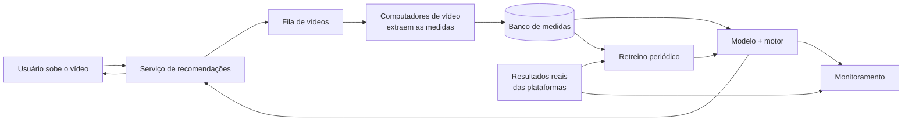

# Pergunta 4.2: como colocar o motor de recomendações em produção?

## Pergunta

Como você colocaria o seu Recommendations Engine em produção? Pense em arquitetura, escalabilidade e como ele se integraria a um produto real. (Não precisa implementar; queremos entender seu raciocínio.)

## Resposta curta

No produto, o fluxo seria assim: o usuário sobe o vídeo no Klike **antes de publicar** e recebe, em segundos, a nota prevista e as três recomendações. Depois que a campanha roda, os resultados reais voltam das plataformas (Meta, TikTok, LinkedIn) e são usados para treinar o modelo de novo, de tempos em tempos.

O sistema tem duas partes com necessidades muito diferentes. **Calcular a nota é leve**: a regressão linear da Parte 2 responde em milésimos de segundo. **Analisar o vídeo é pesado**, se usarmos as medidas da pergunta 4.1, e por isso fica num caminho separado, com computadores próprios para vídeo que crescem conforme a demanda.

Eu começaria simples, com o motor que já existe, e cresceria por etapas. O mais importante não é a tecnologia, e sim **fechar o ciclo**: registrar se o cliente seguiu a recomendação e o que aconteceu depois. É isso que faz o produto aprender com dados reais e permite, um dia, provar que as recomendações funcionam.

## Como as peças se encaixam

O **serviço de recomendações** é o balcão de atendimento. Ele recebe o vídeo e os dados da campanha, chama o modelo e devolve a nota e as recomendações. Na prática, é um programa que fica no ar recebendo pedidos pela internet (uma **API**) e usa o mesmo modelo salvo na Parte 2 e a mesma função de recomendação da Parte 3.

A **fila** guarda os vídeos que esperam análise, como a fila de senhas de um banco. Ela garante que nenhum vídeo se perca quando muita gente envia ao mesmo tempo.

Os **computadores de vídeo** pegam os vídeos da fila e extraem as medidas da pergunta 4.1 (cortes, rosto, texto, fala). Quando a fila cresce, ligam-se mais computadores, como abrir mais caixas num banco cheio.

O **banco de medidas** guarda o resultado da análise de cada vídeo. Se o mesmo vídeo for enviado de novo, ele não é analisado outra vez.

O **retreino periódico** junta, todo mês, as campanhas novas com os resultados reais e treina o modelo de novo, com a mesma avaliação honesta da Parte 2. O modelo novo só substitui o antigo se errar menos em campanhas recentes que nenhum dos dois viu. Cada versão fica guardada, e toda recomendação registra qual versão a gerou. Se algo der errado, volta-se para a anterior.

O **monitoramento** compara a nota prevista com o resultado real quando ele chega, e avisa se o erro subir ou se os vídeos mudarem de perfil (um formato novo, por exemplo).

## Como ele aparece para o cliente

O uso principal é **antes de publicar**: a tela do Klike mostra a nota prevista e as três recomendações, cada uma com o ganho estimado. Um botão de simulação deixaria o usuário ligar e desligar mudanças e ver a nota mudar na hora. É o mesmo "e se" da Parte 3, só que na tela.

Para agências que testam muitas versões de um anúncio, haveria um envio em lote: mandar 50 variações e receber a lista ordenada da melhor para a pior. Essa é a maior força do modelo: na Parte 2, ele acertou 3 de cada 4 dos melhores vídeos.

O Klike também poderia se conectar às ferramentas de anúncio de cada plataforma, para avaliar o vídeo no momento em que ele é cadastrado. Depois da campanha, um relatório compararia a nota prevista com o resultado real.

## Como ele aguenta crescer

Calcular a nota não é o problema. Mesmo milhares de pedidos por minuto são atendidos por algumas cópias do serviço, e dá para ligar cópias extras automaticamente nos horários de pico.

O problema é a análise de vídeo, e há três formas de controlar o custo:

- analisar primeiro só os 3 primeiros segundos e o áudio, onde está o gancho, e deixar o resto para depois;
- nunca analisar o mesmo vídeo duas vezes;
- ligar e desligar computadores de vídeo conforme o tamanho da fila.

Eu também ofereceria duas velocidades: uma **resposta rápida**, só com os dados da campanha (o modelo que já existe), em segundos; e uma **resposta completa**, com a análise do vídeo, em alguns minutos. Se a análise do vídeo falhar, o cliente ainda recebe a resposta rápida.

## Em que ordem eu faria

**Primeiro**, colocaria no ar o serviço com o modelo e o motor que já existem, registrando cada recomendação dada. Isso já entrega valor e começa a juntar dados.

**Segundo**, ligaria a coleta dos resultados reais das plataformas e o retreino mensal. É o que faz o modelo aprender com dados de verdade, em vez dos simulados.

**Terceiro**, acrescentaria a análise de vídeo, começando pelas medidas mais baratas. Só depois do segundo passo, para conseguir medir se as medidas novas realmente diminuem o erro.

**Quarto**, faria testes A/B das recomendações (pergunta 4.3), para provar que elas causam a melhora.

## Riscos e cuidados

**O mundo muda.** As plataformas mudam seus algoritmos e seus formatos, e o modelo de hoje não vale para sempre. Por isso o monitoramento e o retreino.

**Dados reais são diferentes dos simulados.** O erro de cerca de 7 pontos e os efeitos tão limpos deste trabalho provavelmente vão piorar. A primeira tarefa em produção é medir quanto.

**O sistema pode se enganar sozinho.** Se todos os clientes seguirem as recomendações, todos os vídeos passam a ter gancho, e o modelo fica sem vídeos sem gancho para comparar. Testes A/B, e uma pequena parte dos vídeos sem recomendação, mantêm o modelo honesto.

**Os dados são dos clientes.** Vídeos e resultados de cada cliente precisam ficar separados, com regras claras de uso, como exige a LGPD. Sempre que possível, eu guardaria só as medidas, e não os vídeos.

**Explicar sempre.** Cada recomendação deve mostrar de onde vem o número e o quanto se pode confiar nele. É isso que faz um time de marketing confiar no produto.
